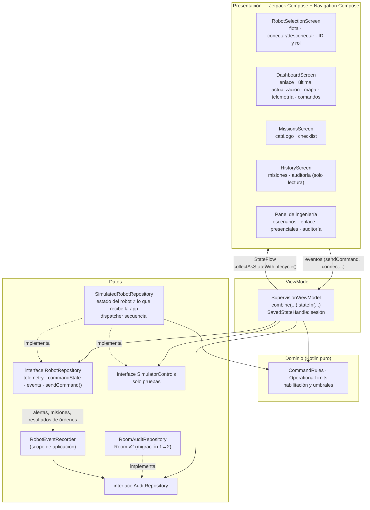
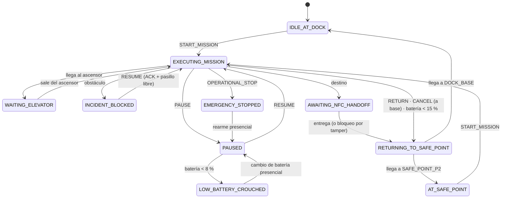

# MediBot G1 — Documentación técnica (arquitectura y máquina de estados)

**UADE — Desarrollo de Aplicaciones I.** App Android (Kotlin 2.0, Jetpack Compose + Material 3, Navigation Compose, Room, corrutinas y StateFlow) para supervisar un Unitree G1 EDU **simulado**, sin servidor ni internet.

El **contrato JSON** (telemetría, solicitud y respuestas de comando), la **matriz de riesgos** y la **matriz de escenarios** están en el [informe técnico](TP%20HMI_HRI%20-%20MediBot%20G1%20(Unitree%20G1%20EDU)%20-%20Informe%20T%C3%A9cnico%20Completo.md), secciones 4.2 y 5. Este documento cubre la arquitectura del código.

---

## 1. Diagrama de arquitectura

**Principios aplicados**

1. **UI = f(estado), con flujo unidireccional:** las pantallas son stateless respecto del dominio; solo guardan estado de UI efímero con `rememberSaveable`.
2. **Repository como gateway:** para conectar un robot real alcanza con implementar `RobotRepository`. Los controles del simulador están en otra interfaz.
3. **Enviar ≠ aceptar ≠ ejecutar:** `CommandExecutionState` es una `sealed interface` (Pendiente, Confirmada, Rechazada, Sin respuesta), con `commandId` y `operatorId`.
4. **Antigüedad del dato:** el enlace que se muestra se deriva de la edad del último paquete. Con más de 4 s se muestra "SIN ENLACE", nunca `ONLINE`.
5. **Auditoría independiente de la UI:** `RobotEventRecorder` vive en el `AppContainer` y persiste aunque no haya pantallas abiertas.
6. **Persistencia segura:** esquema exportado en `app/schemas/`, migraciones explícitas y sin `fallbackToDestructiveMigration`.
7. **Testeable:** el simulador recibe dispatcher, reloj y aleatoriedad, y se prueba con tiempo virtual.

---

## 2. Máquina de estados del robot

*Simplificado. Pausar también aplica durante `RETURNING_TO_SAFE_POINT`, cancelar desde `PAUSED`, `WAITING_ELEVATOR` e `INCIDENT_BLOCKED`, y la detención desde cualquier estado. Las condiciones exactas están en `domain/CommandRules.kt`.*

---

## 3. Umbrales operativos (`OperationalLimits`)

| Umbral | Valor |
| :--- | :--- |
| Batería mínima para iniciar | 20 % |
| Retorno forzado | < 15 % (si el robot camina por su cuenta) |
| Agachado seguro | < 8 % |
| Cápsula en reposo para despachar | ≤ 6.0 °C |
| Ruptura de cadena térmica | máximo del rango de la misión + 0.5 °C |
| Vibración | advertencia > 0.30 G · crítica > 0.60 G |
| Distancia mínima a obstáculo para reanudar | 0.40 m |
| Datos antiguos | > 4 s sin telemetría |
| Timeout de orden | 2.5 s |

---

## 4. Persistencia (Room)

| Tabla | Contenido |
| :--- | :--- |
| `mission_history` | Una fila por **ejecución** (`runId`): estado final, inicio y fin, batería final, temperatura y vibración máximas, notas. |
| `event_log` | Alertas, resultado de cada orden, sesiones, escenarios y borrados, con severidad, misión relacionada y **`operatorId`** (columna agregada en la migración 1→2). |

---

## 5. Pruebas

`./gradlew :app:testDebugUnitTest` corre 24 tests JVM:

- **`CommandRulesTest`:** habilitación de comandos, punto seguro y consola desconectada.
- **`SimulatedRobotRepositoryTest`:** los 5 escenarios y sus variantes (pausa/reanudar, cancelar → base, punto seguro más cercano, retorno forzado, agachado, rearme, cambio de batería, enlace degradado, rango térmico por misión y tamper en destino).
- **`SupervisionViewModelTest`:** validación del ID de operador; el supervisor no puede emitir órdenes y el operador sí, quedando auditado.

Las evidencias visuales de cada escenario están en [`docs/evidencias/`](docs/evidencias/README.md).
