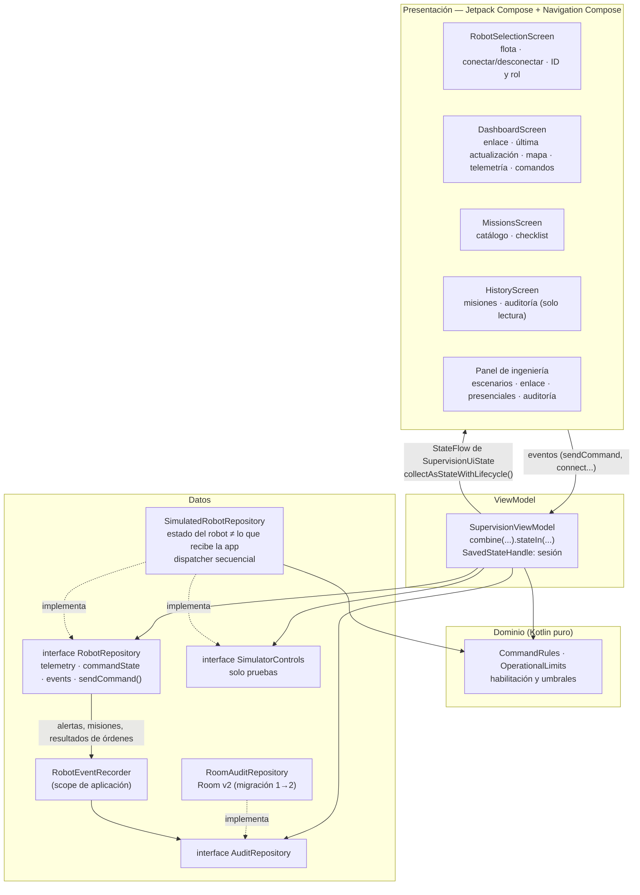
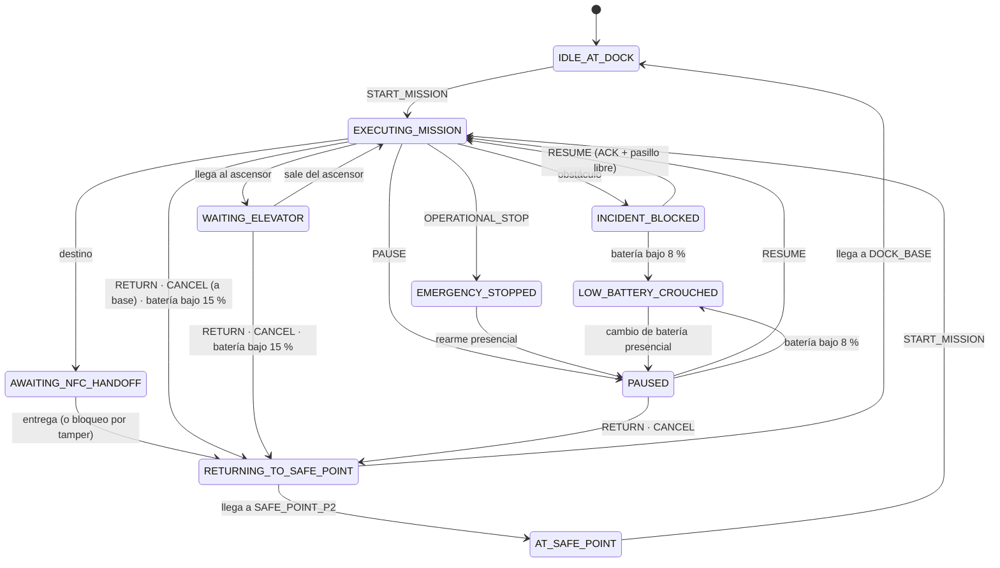

# MediBot G1 — Documentación técnica (arquitectura y máquina de estados)

**UADE — Desarrollo de Aplicaciones I.** App Android (Kotlin 2.0, Jetpack Compose + Material 3, Navigation Compose, Room, corrutinas y StateFlow) para supervisar un Unitree G1 EDU **simulado**, sin servidor ni internet.

Contenido: arquitectura, máquina de estados, umbrales, persistencia, pruebas, comandos y condiciones de habilitación, contrato JSON propuesto, escenarios de prueba y riesgos.

---

## 1. Diagrama de arquitectura



**Principios aplicados**

1. **UI = f(estado), con flujo unidireccional:** las pantallas son stateless respecto del dominio; solo guardan estado de UI efímero con `rememberSaveable`.
2. **Repository como gateway:** para conectar un robot real alcanza con implementar `RobotRepository`. Los controles del simulador están en otra interfaz.
3. **Enviar ≠ aceptar ≠ ejecutar:** `CommandExecutionState` es una `sealed interface` (Pendiente, Confirmada, Rechazada, Sin respuesta), con `commandId` y `operatorId`.
4. **Antigüedad del dato:** el enlace que se muestra se deriva de la edad del último paquete. Con más de 4 s se muestra "SIN ENLACE", nunca `ONLINE`.
5. **Auditoría independiente de la UI:** `RobotEventRecorder` vive en el `AppContainer` y persiste aunque no haya pantallas abiertas.
6. **Persistencia segura:** esquema exportado en `app/schemas/`, migraciones explícitas y sin `fallbackToDestructiveMigration`.
7. **Testeable:** el simulador recibe dispatcher, reloj y aleatoriedad, y se prueba con tiempo virtual.

---

## 2. Máquina de estados del robot



*Simplificado. También se puede pausar durante `RETURNING_TO_SAFE_POINT`, cancelar o regresar desde `INCIDENT_BLOCKED`, y emitir la detención desde cualquier estado. Tras el rearme, el robot vuelve a `INCIDENT_BLOCKED` si el obstáculo sigue presente, y queda en reposo si no tenía misión y está en la base o el punto seguro. El cambio de batería también puede dejarlo en reposo. Las condiciones exactas están en `domain/CommandRules.kt` y `SimulatedRobotRepository`.*

---

## 3. Umbrales operativos (`OperationalLimits`)

| Umbral | Valor |
| :--- | :--- |
| Batería mínima para iniciar | 20 % |
| Retorno forzado | < 15 % (si el robot camina por su cuenta) |
| Agachado seguro | < 8 % |
| Cápsula en reposo para despachar | ≤ 6.0 °C |
| Ruptura de cadena térmica | máximo del rango de la misión + 0.5 °C |
| Vibración | advertencia > 0.30 G · crítica > 0.60 G |
| Distancia mínima a obstáculo para reanudar | 0.40 m |
| Datos antiguos | > 4 s sin telemetría |
| Timeout de orden | 2.5 s |

---

## 4. Persistencia (Room)

| Tabla | Contenido |
| :--- | :--- |
| `mission_history` | Una fila por **ejecución** (`runId`): estado final, inicio y fin, batería final, temperatura y vibración máximas, notas. |
| `event_log` | Alertas, resultado de cada orden, sesiones, escenarios y borrados, con severidad, misión relacionada y **`operatorId`** (columna agregada en la migración 1→2). |

---

## 5. Pruebas

`./gradlew :app:testDebugUnitTest` corre 24 tests JVM:

- **`CommandRulesTest`:** habilitación de comandos, punto seguro y consola desconectada.
- **`SimulatedRobotRepositoryTest`:** los 5 escenarios y sus variantes (pausa/reanudar, cancelar → base, punto seguro más cercano, retorno forzado, agachado, rearme, cambio de batería, enlace degradado, rango térmico por misión y tamper en destino).
- **`SupervisionViewModelTest`:** validación del ID de operador; el supervisor no puede emitir órdenes y el operador sí, quedando auditado.

Cada escenario también se puede reproducir en la app desde el panel de ingeniería (botón violeta).

---

## 6. Comandos y condiciones de habilitación

**Principio de seguridad:** la detención desde la aplicación es un comando de software simulado y **no reemplaza la parada de emergencia física** del robot. Además, **una orden enviada no equivale a una orden ejecutada**. Cada comando lleva un `commandId` y pasa por estados explícitos: `PENDING` → `CONFIRMED`, `REJECTED` o `NO_RESPONSE` (si no hay confirmación en 2500 ms).

**Reglas generales de la consola:**

* **Una orden a la vez:** mientras una orden está pendiente, el resto de los comandos queda deshabilitado. La **Detención Operativa** siempre está disponible y anula la orden pendiente (queda auditado).
* **Confirmación previa:** Cancelar, Regresar a punto seguro y Detención piden confirmación en un diálogo que explica la consecuencia.
* **Sin consola conectada, o con rol supervisor, no se emite ninguna orden** (ver la sección de sesión en el README). Cada orden lleva el `operatorId` de quien la emitió.
* La app valida las condiciones de habilitación y **el robot vuelve a validar**: puede rechazar aunque el botón estuviera habilitado.

| Comando | Condición de habilitación en la interfaz | Respuesta del robot (simulada) |
| :---- | :---- | :---- |
| **1. Iniciar misión** (`START_MISSION`) | Robot en reposo (`IDLE_AT_DOCK` o `AT_SAFE_POINT`), batería ≥ 20 %, cápsula `SEALED_LOCKED` y estable en reposo (≤ 6.0 °C; al despachar se acondiciona al rango de la misión), enlace `ONLINE` con datos frescos. Se muestra como checklist en la vista de Misiones. |<br>• `CONFIRMED`: inicia la marcha a 0.6 m/s.<br>• `REJECTED`: si alguna condición dejó de cumplirse o está activo el rechazo forzado.<br>• `NO_RESPONSE`: si no hay enlace dentro del timeout. |
| **2. Pausar** (`PAUSE_MISSION`) | `EXECUTING_MISSION` o `RETURNING_TO_SAFE_POINT`. |<br>• `CONFIRMED`: el robot se detiene de pie.<br>• `REJECTED`: si está en el ascensor (zona prohibida de detención). |
| **3. Reanudar** (`RESUME_MISSION`) | `PAUSED`, o `INCIDENT_BLOCKED` con todas las alertas críticas reconocidas. |<br>• `CONFIRMED`: retoma la ruta desde el último nodo alcanzado (o el regreso, si estaba regresando).<br>• `REJECTED`: si quedan alertas críticas sin reconocer, o si el LiDAR sigue detectando el obstáculo a menos de 0.40 m. |
| **4. Cancelar misión** (`CANCEL_MISSION`) | Misión activa en `EXECUTING_MISSION`, `PAUSED`, `WAITING_ELEVATOR` o `INCIDENT_BLOCKED`. |<br>• `CONFIRMED`: la misión queda `CANCELLED` en el historial y **el robot regresa a la base** (`DOCK_BASE`). |
| **5. Regresar a punto seguro** (`RETURN_TO_SAFE_POINT`) | Cualquier estado salvo reposo (`IDLE_AT_DOCK`, `AT_SAFE_POINT`), agachado o ya regresando. |<br>• `CONFIRMED`: va al **punto seguro más cercano**: la base en Planta Baja; la bahía `SAFE_POINT_P2` desde el ascensor o el Piso 2. Queda en `IDLE_AT_DOCK` o `AT_SAFE_POINT`. Si había misión, queda `CANCELLED` (carga no entregada).<br>• `REJECTED`: con batería < 8 % (debe agacharse en el lugar). |
| **6. Detención operativa** (`OPERATIONAL_STOP`) | Siempre habilitada en el encabezado para el operador conectado (también con otra orden pendiente, a la que anula). |<br>• `CONFIRMED`: velocidad 0.0 m/s, estado `EMERGENCY_STOPPED` y alerta crítica. **El rearme es solo presencial** (un técnico en el lugar). Después del rearme el robot queda en pausa, y desde la app se puede reanudar, cancelar o regresar. Si el obstáculo de un incidente sigue presente, vuelve a `INCIDENT_BLOCKED`; si no tenía misión y está en la base o en el punto seguro, queda en reposo.<br>• `NO_RESPONSE`: si no hay enlace. |
| **7. Reconocer alerta** (`ACKNOWLEDGE_ALERT`) | Alerta sin reconocer y ninguna orden pendiente. |<br>• `CONFIRMED`: la alerta queda reconocida con la hora del ACK; el resultado se audita en Room.<br>• `REJECTED`: si la alerta no existe o ya estaba reconocida. |

**Recuperaciones presenciales (no son comandos de la app):** el rearme tras una detención y el cambio de batería del robot agachado los hace un técnico en el lugar. En el APK se simulan desde el panel de ingeniería.

---

## 7. Contrato JSON propuesto (telemetría, comandos y respuestas)

*Nota técnica: el siguiente esquema JSON es un contrato de aplicación propuesto para la comunicación entre la HMI y una capa de abstracción (gateway) del robot. **No es el protocolo oficial de Unitree.***

**1. Paquete de telemetría (`telemetry_payload.json`):**

```json
{
  "schemaVersion": "1.0",
  "robotId": "G1-EDU-MED01",
  "firmware": "v2.4.1-DEX3",
  "timestamp": 1793914800120,
  "connectivity": {
    "status": "ONLINE",
    "latencyMs": 38,
    "signalDbm": -56
  },
  "battery": {
    "percentage": 84,
    "tempCelsius": 35.2,
    "estimatedMinutesLeft": 100
  },
  "operation": {
    "state": "EXECUTING_MISSION",
    "missionId": "MED-01-GAS",
    "missionRunId": "MED-01-GAS-7F3A",
    "missionName": "Urgencia: Gases en Sangre -> UTI",
    "progressPct": 75,
    "currentNode": "SAFE_POINT_P2",
    "floor": 2,
    "speedMps": 0.6,
    "posture": "BIPED_WALKING",
    "hri": {
      "ledColor": "#00F5D4",
      "voiceBroadcast": "Unidad médica en tránsito. Conserve su derecha."
    }
  },
  "servicePayload": {
    "compartmentTempCelsius": 4.1,
    "bioSampleStabilityIndexG": 0.14,
    "smartLockState": "SEALED_LOCKED"
  },
  "activeAlerts": [
    {
      "id": "A1B2C3D4",
      "severity": "WARNING",
      "title": "Vibración elevada (0.32 G)",
      "message": "La vibración supera 0.3 G. Considere reducir la velocidad.",
      "timestamp": 1793914790000,
      "acknowledged": true,
      "acknowledgedAt": 1793914795000,
      "relatedMissionRunId": "MED-01-GAS-7F3A"
    }
  ]
}
```

**2. Solicitud de comando (`command_request.json`):**

```json
{
  "commandId": "CMD-9821",
  "robotId": "G1-EDU-MED01",
  "operatorId": "OP-LAB-04",
  "timestamp": 1793914805000,
  "action": "PAUSE_MISSION",
  "parameters": {
    "reason": "Verificación manual de pasillo por operador"
  }
}
```

**3. Respuestas de comando (`command_response.json`):**

```json
{
  "commandId": "CMD-9821",
  "operatorId": "OP-LAB-04",
  "timestamp": 1793914806200,
  "status": "CONFIRMED",
  "robotStateAfter": "PAUSED",
  "message": "Marcha pausada de forma segura en Piso 2 - Receso Seguro de Espera."
}
```

```json
{
  "commandId": "CMD-9822",
  "timestamp": 1793914812400,
  "status": "REJECTED",
  "errorCode": "ERR_UNSAFE_ELEVATOR_THRESHOLD",
  "message": "No se puede pausar mientras cruza el umbral o espera en el ascensor."
}
```

```json
{
  "commandId": "CMD-9823",
  "timestamp": 1793914890500,
  "status": "NO_RESPONSE",
  "errorCode": "ERR_LINK_TIMEOUT",
  "message": "Sin confirmación del robot tras 2500 ms. No se sabe si la orden se ejecutó."
}
```

*`NO_RESPONSE` lo genera la propia app al vencer el timeout: el robot no lo envía. Los `errorCode` y el campo `parameters` son parte de la propuesta de contrato; el simulador informa el motivo como texto en `message`.*

---

## 8. Escenarios de prueba

El APK incluye un **panel de ingeniería** (botón flotante violeta) que dispara los 5 escenarios obligatorios. Cada escenario también tiene un test unitario automatizado.

| Escenario | Disparo | Comportamiento del robot y de la HMI | Acción del operador y resultado |
| :---- | :---- | :---- | :---- |
| **1. Misión normal** | "E1" en el panel, o despacho desde Misiones con el checklist completo. | El robot parte del Laboratorio Central con 85 % de batería y la cápsula a 4.0 °C. Pasa la puerta cortafuego y el ascensor (enlace `DEGRADED` dentro de la cabina) hasta la UTI. | Validación NFC simulada → misión `COMPLETED` en el historial. El robot despeja el puesto y espera en el punto seguro del Piso 2; la cápsula se vuelve a sellar. |
| **2. Batería baja** | "E2" (ocurre durante una misión). | Batería al 19 %: alerta `WARNING` y descarga acelerada. Iniciar misión queda bloqueado. | El operador reconoce y ordena **Regresar** (punto seguro más cercano): misión `CANCELLED` y robot a salvo. Si nadie actúa, al bajar del **15 %** el robot hace un **retorno forzado** (alerta crítica). Si estaba pausado y la batería baja de 8 %, se agacha (`LOW_BATTERY_CROUCHED`), la misión queda `FAILED` y se recupera con **cambio de batería presencial**. |
| **3. Desconexión** | "E3". | La app deja de recibir telemetría. A los 4 s: **SIN ENLACE**, `DATOS ANTIGUOS` y tarjetas atenuadas. El robot sigue su misión de forma autónoma. | Una orden enviada queda `PENDIENTE` y pasa a `SIN RESPUESTA` a los 2,5 s. Con "Restablecer enlace" vuelve la telemetría en vivo y llegan los eventos ocurridos durante el corte. |
| **4. Incidente** | "E4". | En la puerta cortafuego: `INCIDENT_BLOCKED`, velocidad 0 y alerta `CRITICAL` ("camilla a 0.35 m"). | Reanudar se habilita al reconocer la alerta. El robot **rechaza** reanudar mientras el obstáculo esté a menos de 0.40 m; el pasillo se despeja a los ~10 s. Alternativa: desviar a punto seguro (la base, en PB). |
| **5. Escenario propio: cadena de frío y manipulación** | "E5" (afecta la misión en curso; si no hay ninguna, inicia una de hemoterapia). | La cápsula sube a **8.4 °C** y la cerradura pasa a `TAMPER_ALERT`: dos alertas `CRITICAL` y tarjetas en rojo. | El operador reconoce y **cancela** (el robot vuelve a la base y la misión queda `CANCELLED` con la temperatura máxima registrada) o desvía a punto seguro. Si nadie interviene, al llegar a destino la cápsula manipulada **no se libera**: la misión queda `FAILED` y la carga se retiene para inspección. |

---

## 9. Riesgos operativos y mitigaciones

| # | Riesgo operativo / HRI | Impacto potencial | Medidas de mitigación (interfaz, lógica y procedimiento) |
| :---- | :---- | :---- | :---- |
| **1** | **Órdenes accidentales o contradictorias** (tocar Cancelar o Detención por error, o enviar dos órdenes seguidas). | Interrupción injustificada de un traslado urgente o frenado brusco. | **Interfaz:** confirmación modal en Cancelar, Regresar, Detención, Desconectar y Borrar historial, con botones de 48 dp separados. **Lógica:** una sola orden pendiente a la vez; solo la Detención puede anularla, y queda auditado. |
| **2** | **Decisiones basadas en telemetría congelada** (micro-cortes entre pisos o en el ascensor). | El operador cree que el robot sigue en un estado que ya cambió. | **Lógica y visual:** la última actualización siempre está a la vista; a los 4 s se marca **SIN ENLACE** / datos antiguos (nunca `ONLINE` con datos viejos); timeout real de 2,5 s → `SIN RESPUESTA` ("no se sabe si se ejecutó"). |
| **3** | **Colisión con personal, pacientes o camillas.** | Lesiones o caída del robot con pérdida de muestras. | **HRI y control:** velocidad limitada a 0.8 m/s; detención automática ante obstáculos (`INCIDENT_BLOCKED`) y reanudación solo con el pasillo despejado y la alerta reconocida; mensajes de voz y luz de estado. |
| **4** | **Desplome del humanoide (35 kg) por batería agotada.** | Daño al robot, rotura de muestras y riesgo para personas cercanas. | **Lógica:** sin misiones nuevas con batería < 20 %, alerta de batería baja con acción de regreso, **retorno forzado automático bajo 15 %**, agachado seguro bajo 8 % si no puede caminar, y recuperación solo con cambio de batería presencial. |
| **5** | **Privacidad de pacientes y acceso no autorizado a muestras.** | Exposición de imágenes clínicas y sustracción de material. | **Procedimiento y hardware:** la app usa un mapa esquemático y no transmite ni graba video; la cápsula tiene cerradura NFC con alerta de manipulación (`TAMPER_ALERT`); la consola solo opera conectada a un robot de la flota, con ID y rol (el supervisor no puede comandar), y registra cada conexión y cada orden con su operador. El historial es de solo lectura para el operador. |
